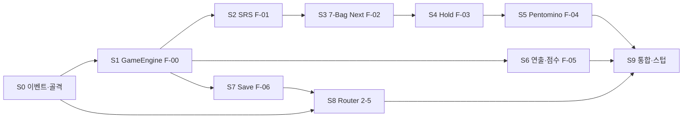

# 역할 A 담당 — 기획서 & 세션별 구현 프롬프트

> **대상:** 3조 테트리스 (Java 17, Swing, Maven)  
> **전제:** `Tetris.java` / `Board.java` / `Shape.java` / `Tetrominoes.java` 튜토리얼 베이스는 **이미 동작**한다.  
> **A 목표:** 명세 F-00~F-06 + 2-5절(화면 라우터) + 코어·piece·Save·Router **소유 범위**를 베이스 위에 **세션 단위로** 붙인다.  
> **코딩 톤:** 팀 공통 규칙(학생이 급하게 붙인 코드, God Class 허용, 1인 먼저·2인은 복사 분기) + **명세 AC는 반드시 충족**.

---

## 1. A 담당 범위 (명세 [표 1-2])

| 구분 | 포함 | 제외 (다른 담당, 최소 접촉만) |
|------|------|--------------------------------|
| **기능 ID** | F-00, F-01~F-06 | F-07~F-09 → **B**, F-10~F-15 → **C** |
| **절** | 2-5 화면 라우팅, 3-2 블록·코어, 4-2 core, 4-3 piece, 4-9 SaveService·메멘토, 4-12 ui.router | 3-5 보드 명세·Board 클래스 **소유는 B** |
| **패키지 (목표)** | `core`(GameEngine, GameSession, ScoreCalculator), `piece`, `event`(버스 최초), `persistence`(SaveService, 메멘토), `ui.router`, `app`/`view` 중 A가 필요한 최소 화면 | `input` 전체(B), `stage`/`state`/`audio`/`recognition`(C), AccountService(B) |

**조정 점수:** 4.0 + 코어 (전제 F-00).

---

## 2. 베이스에 이미 있는 것 vs A가 새로/고쳐야 하는 것

### 2.1 이미 있음 (재사용·점진 이전)

| 파일 | 있는 기능 | 명세와의 갭 |
|------|-----------|-------------|
| `Board.java` | 10×**22**, Timer 낙하, 이동·(단순) 회전, 줄 삭제, pause, game over 문자열 | 가시 20 + 숨김 **4 = 24행**, SRS·이벤트·세션 분리 없음 |
| `Shape.java` | tetromino 좌표, rotateLeft/Right, random `% 7 + 1` | **7-Bag**, PieceType, SRS 킥 없음 |
| `Tetris.java` | JFrame + Board + statusbar | 라우터·모드 선택·Next/Hold UI 없음 |

### 2.2 A가 만들어야 하는 것 (기능 단위)

| ID | Must/Should | 한 줄 |
|----|-------------|--------|
| F-00 | Must | 세션·GameEngine·점수 규칙·**이벤트 발행** (B의 Board API와 맞추거나, B 전까지 어댑터) |
| F-01 | Must | SRS + KickTable (I/O/T 별) |
| F-02 | Must | SevenBagRandomizer + Next 미리보기 |
| F-03 | Must | Hold (연속 동종 홀드 금지, 꺼낸 블록 rotation 0) |
| F-04 | Must | 펜토미노 + PentominoPolicy (스테이지 1~2 미등장) |
| F-05 | Should | 줄 깜빡임 300ms, 연출 중 입력 무시, GO 회색조 |
| F-06 | Should | GameMemento, SaveService, 슬롯 3, PAUSED에서 저장·복원 |
| 2-5 | — | Route enum, ScreenRouter, AuthGuard·LeaveGuard **골격** (화면 UI는 B/C와 분담) |

### 2.3 팀 협업 경계 (A가 기억할 것)

- **Board / CellType / BoardSnapshot:** B 소유 → A는 `GameSession`이 Board **인터페이스 또는 B PR 머지 후** 사용. B 전에는 기존 `Board` 패널 로직을 `GameEngine`으로 **옮기기만** 하고, 24행·CellType은 B PR 후 맞춘다.
- **InputHandler / KeyBindings:** B → A는 `GameEngine`에 `onAction(player, action)` 같은 **진입점**만 열어 둔다.
- **StageManager / Boss:** C → A는 `LINES_CLEARED`, `GAME_OVER` 등 **이벤트만** 발행; C가 구독.
- **AuthGuard / LOGIN:** B(F-09) → A 라우터는 `RouteGuard`로 **리다이렉트 훅**만 구현; 실제 로그인 UI는 B.

---

## 3. 의존 순서 (세션 순서 근거)



---

## 4. 세션 로드맵 요약

| 세션 | 주제 | 산출물 | B/C 의존 |
|------|------|--------|----------|
| **S0** | 프로젝트 골격 + 이벤트 버스 | `GameEvent`, `GameEventBus`, Maven `pom.xml` 초안, 패키지 디렉터리 | 없음 |
| **S1** | F-00 GameEngine / GameSession | Timer → engine.tick, lock/line clear/GAME_OVER 이벤트 | B Board 나중에 교체 가능하게 |
| **S2** | F-01 SRS | `KickTable`, `SrsRotationSystem`, I/O/T AC | 없음 |
| **S3** | F-02 7-Bag + Next | `SevenBagRandomizer`, Next UI(패널) | 없음 |
| **S4** | F-03 Hold | `HoldSlot`, 키 C(1인) | B 키 설정 나중에 연결 |
| **S5** | F-04 펜토미노 | PieceType P5_*, factory, stage≥3 정책 | C StageManager stage 번호 **스텁 int** |
| **S6** | F-05 + ScoreCalculator | 깜빡임, GO grayscale, 점수 공식 | C SFX는 이벤트만 |
| **S7** | F-06 Save/Load | `GameMemento`, `SaveService`, Gson, atomic save | B AuthGuard 연동은 S8 |
| **S8** | 2-5 ScreenRouter | Route, navigate/replace/back, AuthGuard, TITLE→MODE→GAME | B LOGIN 화면 스텁 |
| **S9** | 통합·2인 준비 | `isTwoPlayer`·p2 필드 **최소**, C StageManager mock 구독 | B F-07 본격, C F-10 |

**원칙:** 한 세션 = **한 PR** 권장. 세션 끝마다 1인 모드 수동 테스트 + 기존 `Board` 직접 실행 경로가 깨지지 않게 유지(또는 `Main`/`Tetris` 진입점을 router로 전환).

---

## 5. 세션별 상세 + 복붙용 프롬프트

아래 프롬프트를 Cursor에 **세션 번호 하나씩** 붙여 넣는다. 공통으로 맨 위에 팀 규칙 블록을 같이 붙여도 된다.

### 공통 프롬프트 머리글 (매 세션 앞에 붙이기)

```markdown
# 역할
Java Swing 테트리스 2학년 팀 프로젝트. 역할 **A**만 수정. B/C 파일은 필요 시 import·호출만.

# 원칙
- 동작·AC 우선. 베이스(Board/Shape)는 점진 이전; 한 번에 전부 갈아엎지 말 것.
- 1인 모드 먼저. 2인은 S9까지 미루거나 boolean + TODO.
- 산출: 코드 + [팀 내부용] 설명서 + SMELL_LOG + 체크리스트 + 타 담당 깨짐 여부.

# 레포
- 패키지 현재: kr.ac.jbnu.se.tetris (명세 목표: kr.jbnu.tetris — 세션마다 점진 이동 OK)
- 명세: `_spec_extract.txt` / docx
```

---

### S0 — 이벤트·빌드 골격

**목표:** 코어가 UI·저장을 모르게, 줄 삭제·보스·사운드가 붙을 **Observer 자리** 확보.

**In:** `GameEventType` 초안, `GameEventBus`, Maven(Gson, JUnit5), `data/` 폴더 .gitkeep  
**Out:** GameEngine 본체, 화면 라우터

**인수 (자체):**
- `publish` 후 구독자 `onEvent` 호출됨
- core/piece 패키지가 persistence, view import 안 함

<details>
<summary><strong>S0 프롬프트 (복사)</strong></summary>

```markdown
[공통 머리글]

## 이번 세션: S0 — GameEventBus + Maven 골격

### 할 일
1. 루트에 `pom.xml` (Java 17, Gson, JUnit5). IntelliJ Maven import 가능 수준.
2. `event` 패키지: `GameEventType`(PIECE_LOCKED, LINES_CLEARED, GAME_OVER, LINE_CLEAR_ANIM_START/END 등 F-05·C 연동에 필요한 최소), `GameEvent`, `GameEventListener`, `GameEventBus`(subscribe by type, publish).
3. `data/.gitkeep` — NFR-07 상대 경로.
4. 기존 `Tetris.main` 실행은 **그대로** 동작하게 둔다. 새 코드는 테스트 또는 빈 Main 호출로만 검증해도 됨.

### 하지 말 것
- Board 대수술, SRS, 라우터, Save

### 완료 기준
- JUnit으로 bus publish/subscribe 1테스트
- [팀 내부용] 설명서 + SMELL_LOG + 체크리스트
```
</details>

---

### S1 — F-00 GameEngine / GameSession

**목표:** `Board`의 Timer·lock·line clear를 **GameEngine + GameSession(1개)** 로 이전(또는 Board가 GameEngine을 delegating). 이벤트 발행.

**In:** AC-00-1~3, 점수는 S6까지 statusbar 숫자만 맞춰도 됨  
**Out:** SRS, 7-Bag

**B 협업:** `GameSession` 생성자에 `Board` 자리 — 지금은 기존 grid 로직 내장 또는 `Board` 참조 1개.

<details>
<summary><strong>S1 프롬프트 (복사)</strong></summary>

```markdown
[공통 머리글]

## 이번 세션: S1 — F-00 GameEngine / GameSession

### 할 일
1. `GameEngine`: mode SINGLE, `List<GameSession>`, `GameEventBus`, Timer(400ms) → `tick()`.
2. `GameSession`: playerIndex 0, 현재 피스·좌표·board 배열(기존 Board 로직 이전), `tryMove`, lock, `removeFullLines`.
3. lock 시 `PIECE_LOCKED`, 줄 삭제 시 `LINES_CLEARED`(value=줄 수), 스폰 불가 시 `GAME_OVER` 1회.
4. `GamePanel` 또는 기존 `Board`가 engine을 호출하고 `paint`는 session 상태를 그림. 키 입력은 기존 KeyAdapter → engine.move/rotate/drop.
5. 명세 점수 공식은 주석 TODO; statusbar는 줄 수 또는 임시 score.

### AC
- AC-00-1 겹침·범위 밖 이동 불가
- AC-00-2 다중 줄 동시 삭제
- AC-00-3 스폰 막히면 GAME_OVER 1회

### 하지 말 것
- SRS(아직 Shape rotate 그대로), Hold, Router, Save

### 완료 기준
- 1인 플레이 end-to-end (튜토리얼과 동등 이상)
- 이벤트 리스너 등록 예시 1개 (System.out 또는 테스트)
- 설명서 + SMELL_LOG + 체크리스트
```
</details>

---

### S2 — F-01 SRS

**목표:** `RotationSystem` / `SrsRotationSystem` / `KickTable`. I 전용 테이블, O 무회전, 5킥 실패 시 원위치.

**In:** AC-01-1~4  
**Out:** 7-Bag

<details>
<summary><strong>S2 프롬프트 (복사)</strong></summary>

```markdown
[공통 머리글]

## 이번 세션: S2 — F-01 SRS + KickTable

### 할 일
1. `piece` 패키지: `RotationState`(SPAWN,R,TWO,L), `KickTable.offsets(...)`, `SrsRotationSystem.rotate(piece, cw/ccw)`.
2. T 벽킥, I 전용 킥, O는 coords unchanged.
3. `GameSession` 회전 시 최대 5 offset 시도, 전부 fail → 위치·회전 유지.
4. 기존 `Shape`는 점진 폐기 또는 Piece record로 감싸기.

### AC
- AC-01-1 ~ AC-01-4 (명세 `_spec_extract.txt` F-01)

### 완료 기준
- 벽 붙은 T/I 수동 테스트 시나리오 3개 문서화
- 1인 플레이 회전이 SRS로 동작
- 설명서 + SMELL_LOG + 체크리스트
```
</details>

---

### S3 — F-02 7-Bag + Next

**목표:** `Randomizer` / `SevenBagRandomizer`, 시드 고정, Next UI 1~N칸(명세: 첫 Next = 실제 다음 스폰).

**In:** AC-02-1~4  
**Out:** Hold

<details>
<summary><strong>S3 프롬프트 (복사)</strong></summary>

```markdown
[공통 머리글]

## 이번 세션: S3 — F-02 SevenBag + Next 미리보기

### 할 일
1. `SevenBagRandomizer`: 7종 한 번씩 셔플, `long seed`, `RandomizerState` for save.
2. `GameSession`: spawn pipeline — peek next, spawn 후 advance.
3. UI: GamePanel 옆 `JLabel` 또는 작은 JPanel에 Next 1개 이상 표시.
4. `setRandomShape()` `% 7` 제거.

### AC
- AC-02-1 ~ AC-02-4

### 완료 기준
- 같은 seed 두 번 → 동일 순서 (간단 JUnit)
- Next 화면과 다음 스폰 블록 일치
- 설명서 + SMELL_LOG + 체크리스트
```
</details>

---

### S4 — F-03 Hold

**목표:** `HoldSlot`, 키 C, 연속 동종 홀드 금지, swap 시 spawn rotation 0.

**In:** AC-03-1~3  
**Out:** Pentomino

<details>
<summary><strong>S4 프롬프트 (복사)</strong></summary>

```markdown
[공통 머리글]

## 이번 세션: S4 — F-03 Hold

### 할 일
1. `HoldSlot`: hold/swap, `holdLocked` 플래그(한 번 hold 후 lock, lock 해제는 피스 land).
2. 홀드 UI (작은 preview).
3. hold로 나온 피스 spawn rotation SPAWN(0).
4. hold 직후 spawn 막히면 top out / GAME_OVER.

### AC
- AC-03-1 ~ AC-03-3

### 완료 기준
- 연속 같은 블록 hold 불가 수동 테스트
- 설명서 + SMELL_LOG + 체크리스트
```
</details>

---

### S5 — F-04 펜토미노

**목표:** P5_P/U/V/X/F, PentominoPolicy, stage 1~2 미등장, bag에 테트로미노 7종 유지.

**In:** AC-04-1~3  
**Out:** B Board CellType — 펜토미노는 PieceType enum + coords

**C 협업:** `engine.getStage()` 또는 `stageNumber` int; C `StageManager` 없으면 `stageNumber=1` 고정 테스트 / 3 이상 테스트용 메뉴.

<details>
<summary><strong>S5 프롬프트 (복사)</strong></summary>

```markdown
[공통 머리글]

## 이번 세션: S5 — F-04 Pentomino

### 할 일
1. `PieceType`에 P5_* 추가, 5칸 coords, SRS 또는 명세 킥 테이블(펜토미노용 KickGroup).
2. `PentominoPolicy`: stage<=2 insert 금지, stage>=3 일정 확률/규칙으로 bag에 삽입(명세 AC-04-3).
3. Hold/회전/줄삭제 동일 적용.

### AC
- AC-04-1 ~ AC-04-3

### 완료 기준
- stage 1에서 P5 없음, stage 3 테스트 시 P5 등장
- 설명서 + SMELL_LOG + 체크리스트
```
</details>

---

### S6 — F-05 연출 + ScoreCalculator

**목표:** 줄 삭제 전 300ms blink, 연출 중 tick/입력 무시, GAME_OVER grayscale. 점수: 1/2/3/4줄 ×100/300/500/800 × stage.

**In:** AC-05-1~3, AC-10 연동은 C가 데미지 — A는 LINES_CLEARED value만 정확히  
**Out:** Save

<details>
<summary><strong>S6 프롬프트 (복사)</strong></summary>

```markdown
[공통 머리글]

## 이번 세션: S6 — F-05 연출 + ScoreCalculator

### 할 일
1. `LINE_CLEAR_ANIM` 상태: 300ms blink, numFullLines>0 시 lock 후 애니 시작, 끝난 뒤 줄 삭제·점수.
2. 애니 중 `InputHandler`/`keyPressed` early return (버퍼 없음).
3. `ScoreCalculator`: soft 1, hard 2, line table × stage.
4. GAME_OVER: RenderOptions grayscale + "GAME OVER" (F-05 AC-05-3).

### AC
- AC-05-1 ~ AC-05-3

### 완료 기준
- 2줄 동시 삭제 시 blink 후 한 번에 반영
- 설명서 + SMELL_LOG + 체크리스트
```
</details>

---

### S7 — F-06 Save / Load

**목표:** `GameMemento`, `SessionMemento`, `SaveService`, Gson, atomic move, version=1. 복원 후 **PAUSED**. 손상 파일 → LoadException, 크래시 X.

**In:** AC-06-1~3  
**Out:** Router (슬롯 UI는 S8 OVERLAY)

**B 협업:** userId는 `AccountService.currentUser` 스텁 `"testuser"` 가능.

<details>
<summary><strong>S7 프롬프트 (복사)</strong></summary>

```markdown
[공통 머리글]

## 이번 세션: S7 — F-06 SaveService + Memento

### 할 일
1. `GameEngine.createMemento()` / `restoreFrom(GameMemento)`: board snapshot, active, rotation, xy, RandomizerState, hold, score, lines, mode, elapsedMs.
2. `StageMemento`는 C API 스텁(empty HP) — C PR 후 필드 확장 TODO.
3. `SaveService`: save/load/listSlots/delete, slot 1~3, `data/saves/{userId}/slot{n}.json`, ATOMIC_MOVE.
4. 손상 JSON → LoadException, UI 없이 JUnit으로 검증.

### AC
- AC-06-1 ~ AC-06-3

### 완료 기준
- save → load → board/next/hold/score 동일
- load 후 rng sequence가 no-save와 동일 (AC-06-2)
- 설명서 + SMELL_LOG + 체크리스트
```
</details>

---

### S8 — 2-5 ScreenRouter

**목표:** 단일 JFrame, CardLayout, Route enum, navigate/replace/back, OVERLAY(PAUSE, SAVE_SLOTS), AuthGuard(비로그인 SAVE_SLOTS → LOGIN redirect **스텁**), LeaveGuard(GAME→TITLE 확인).

**In:** [표 2-5] R-01~R-11 경로·유형  
**Out:** B가 LOGIN/SETTINGS 화면 채움

<details>
<summary><strong>S8 프롬프트 (복사)</strong></summary>

```markdown
[공통 머리글]

## 이번 세션: S8 — ScreenRouter (2-5절)

### 할 일
1. `Route`, `RouteType`(SCREEN/OVERLAY), `RouteParams` record들(LoginParams, GameParams, SaveSlotParams 등 최소).
2. `ScreenRouter`: navigate, replace, back, guard chain.
3. `AuthGuard`: SAVE_SLOTS/RECORDS + guest → REDIRECT LOGIN (Login 화면은 placeholder JPanel).
4. `TitleScreen` → MODE_SELECT → GAME(SINGLE). PAUSE overlay: resume → engine, Save → SAVE_SLOTS overlay.
5. `Main` 또는 `GameWindow`가 router 부트. 기존 `Tetris.main`은 deprecated comment 또는 router로 위임.

### 명세
- `_spec_extract.txt` [표 2-5], [표 2-6] GameState↔Router 호출 지점
- replace: LOGIN 성공, RESULT (RESULT는 C/공통 — placeholder OK)

### 완료 기준
- TITLE → 1인 → GAME → P pause → back resume
- 게스트 SAVE_SLOTS 진입 시 LOGIN placeholder
- 설명서 + SMELL_LOG + 체크리스트
```
</details>

---

### S9 — 통합 · 2인 준비 · C 연동 스텁

**목표:** `StageManager` mock 또는 C jar/PR 구독으로 LINES_CLEARED 수신 확인. GameEngine `COOP_LOCAL` 골격(p2 session duplicate). **본격 F-07은 B.**

**In:** AC-07은 B 검증 — A는 session 2개 생성·tick만  
**Out:** 없음 (A 1차 마무리)

<details>
<summary><strong>S9 프롬프트 (복사)</strong></summary>

```markdown
[공통 머리글]

## 이번 세션: S9 — 통합 + 2인·C 연동 준비

### 할 일
1. `GameEngine.start(COOP_LOCAL)`: session 2개, 다른 Randomizer seed.
2. C `StageManager` 없으면 `TestBossListener`: LINES_CLEARED → System.out damage.
3. 2인 그리기: GamePanel 좌우 또는 boolean isTwoPlayer 분기 **최소** (B F-07에서 확장).
4. 회귀: 1인 SRS, Hold, Save, Router 전 경로 수동 테스트.

### 완료 기준
- 1인 전 기능 회귀 체크리스트 통과
- 2인 session 2개 tick 시 p1/p2 독립 (키는 B 전까지 하드코딩 OK)
- 설명서 + SMELL_LOG + 체크리스트 + B/C에게 넘길 API 메모
```
</details>

---

## 6. A 산출물 체크리스트 (전 세션 공통)

매 세션 PR 전에:

- [ ] `_spec_extract.txt` 해당 F-xx **AC** 전부 수동 또는 JUnit
- [ ] B 소유 파일(`Board` 명세版) **직접 수정 없음** — 필요 시 PR 요청 주석
- [ ] C `stage` 패키지 **미구현** 시 스텁으로 컴파일
- [ ] `Tetris.main` 또는 `GameWindow.main` 실행 가능
- [ ] [팀 내부용] 설명서 · SMELL_LOG · 동작 체크리스트(1인; 2인 해당 시)

---

## 7. 발표·2차 리팩터링용 메모 (A)

| 나중에 풀 냄새 | 예상 위치 | 명세가 원하는 방향 |
|----------------|-----------|-------------------|
| God Class | GamePanel/Board | GameEngine + view 분리 (이미 명세) |
| 모드 분기 산개 | tick, paint, key | GameSession[] + InputHandler(B) |
| 메멘토 필드 누적 | GameMemento | StageMemento C와 버전 협상 |
| 라우터 vs GameState | PAUSE | [표 2-6] 호출 지점만 유지 |

---

## 8. 다음 액션

1. **S0 프롬프트**부터 Cursor에 붙여 실행.  
2. B/C와 **S1 Board API**, **S7 StageMemento**, **S8 LOGIN 화면** 합류 시점을 팀 채팅에 공유.  
3. 패키지명 `kr.jbnu.tetris` vs `kr.ac.jbnu.se.tetris` — 스프린트 0에서 한 번만 정하고 S0~S1에서 migrate.

---

*문서 버전: 2026-09-23 · 근거: `3조_테트리스_기능명세서_API명세서 (1).docx` → `_spec_extract.txt`*
