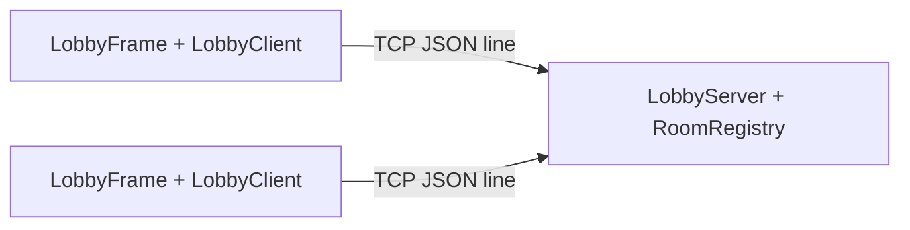

# 팀 핸드오프 — 온라인 로비 · 협동 모델 · 실행/ Git 주의사항

> **대상:** 1PC 2P·보스·UI 담당, PR/머지 담당, AI 보조 코딩하는 팀원  
> **작성 기준:** 2026-09-29 로비 MVP 구현 스냅샷  
> **진입점:** 게임 `kr.ac.jbnu.se.tetris.app.GameWindow` · 로비 서버 `kr.ac.jbnu.se.tetris.network.lobby.LobbyServerMain`

---

## 0. 이 문서를 언제/어떻게 쓰나

| 질문 | 답 |
|------|-----|
| 로컬 1PC 2P 설계는 서버 코드에 묶이나? | **협동 “모델”(공유 스테이지 + 플레이어 2세션)은 안정적.** **온라인은 로비(`roomId`) + 이후 in-game 프로토콜**만 서버 구현에 맞춰 연결하면 됨. |
| 오늘 서버 구현 후에 이 MD를 쓰는 게 맞나? | **맞음.** §3·§4는 **오늘 구현 기준 스냅샷**. in-game 붙이면 §4.3 “다음 단계”와 `docs/lobby-protocol.md`만 갱신. |
| AI에게 뭘 주면 되나? | 이 파일 + `docs/lobby-protocol.md` + (코드 작업 시) `src/kr/ac/jbnu/se/tetris/network/lobby/**` |

---

## 1. 팀 채팅에 붙여넣을 5줄 (실행)

```
[실행]
1. clone 후 IntelliJ → Tetrise2026_3 루트만 Open (pom.xml 보이는 폴더)
2. Tetrise2026_3-main / tetris2026-master 폴더 열지 말 것
3. Run: GameWindow (kr.ac.jbnu.se.tetris.app.GameWindow)
4. 안 되면: Project Structure → Sources = src + src/main/java (파란), test + src/test/java (초록)
5. Rebuild Project → docs/RUN-INTELLIJ.md · docs/team-handoff-coop-network.md 참고
```

**온라인 로비 테스트 추가:**

```
6. Run: LobbyServerMain (별도 Run 탭, 포트 8765) → 게임 타이틀 「온라인 협동」→ 「서버 연결」
```

---

## 2. Git / PR — 올릴 것 · 말 것 · 재발 방지

### 2.1 PR 한 번에 올릴 것 (코드 + 실행/IDE)

| 구분 | 경로 |
|------|------|
| 코드 | `src/`, `test/`, `pom.xml`, `scripts/compile.ps1` |
| B 통합 등 | `src/main/java/**` (예: `GamePanel`, `LobbyFrame`, `LoginFrame`, `ASinglePlayerBridge`) |
| A 코어/로비 | `src/kr/ac/jbnu/se/tetris/**` (예: `network/lobby/*`, `core/*`) |
| IDE (팀 공유) | `tetris2026.iml`, `.idea/modules.xml`, `.idea/libraries/JUnit5.xml`, `.idea/libraries/Gson.xml`, `.idea/runConfigurations/GameWindow.xml`, `.idea/runConfigurations/LobbyServerMain.xml` |
| JUnit (Maven 없이 테스트) | `lib/test/*.jar` |
| Gson (Maven 없이 컴파일) | `lib/gson-2.11.0.jar` |
| 문서 | `docs/RUN-INTELLIJ.md`, `docs/lobby-protocol.md`, **본 문서** |

### 2.2 올리지 말 것

- `out/`, `target/` (`.gitignore` 처리됨)
- `.idea/workspace.xml` (개인 창 레이아웃 — `.gitignore`에 제외 권장)
- `Tetrise2026_3-main/` 같은 **복사본 폴더 전체** (repo에 없어야 함)

### 2.3 팀 규칙 4개 (이번 같은 사고 방지)

| 규칙 | 이유 |
|------|------|
| 머지할 때 폴더 통째 복사 금지 | `Tetrise2026_3-main` 중복 · classpath/Sources 꼬임 |
| 코드는 **루트 `src/`에만** | A=`src/kr`, B=`src/main/java`, 리소스=`src/main/resources` |
| `.idea`는 **Run + iml + libraries**만 공유 | Sources/JUnit/Gson 맞춤; `workspace.xml`은 개인 |
| PR 전 **본인 PC에서 GameWindow Run** | “나만 됨” 방지 |

**한 줄 합의:** 루트만 연다 · GameWindow Run · 복사본 폴더 금지 · iml/Run 설정은 Git.

### 2.4 PR/머지 체크리스트 (1명만 봐도 됨)

- [ ] 루트에서 **GameWindow** 실행됨  
- [ ] (로비 담당 PR이면) **LobbyServerMain** 실행 후 **온라인 협동** 연결·방 생성 가능  
- [ ] 1인 플레이 → A 보드(`ASinglePlayerBridge`) + B UI  
- [ ] `Tetrise2026_3-main` 같은 복사본 **repo에 없음**  
- [ ] `pom.xml`의 A 소스 루트는 **`src`** (`build-helper` — `src/kr`만이 아님)  
- [ ] `package com.google.gson does not exist` 없음 → **Gson** library / `lib/gson-2.11.0.jar`  

### 2.5 자주 터진 에러 (Gson / Sources)

| 증상 | 원인 | 조치 |
|------|------|------|
| `package com.google.gson does not exist` | IntelliJ가 Maven이 아니라 **iml**만 보는데 Gson 미연결 | `tetris2026.iml`에 Gson library · `lib/gson-2.11.0.jar` · Rebuild |
| GameWindow는 되는데 로비만 실패 | **LobbyServerMain 미실행** | 서버 Run 먼저, 포트 **8765** |
| ClassNotFound / 소스 안 맞음 | **잘못된 폴더 Open** 또는 Sources 누락 | `docs/RUN-INTELLIJ.md` §2 |

---

## 3. IntelliJ / 터미널 — 실행 순서 (로비 확인)

### 3.1 IntelliJ (권장)

1. **LobbyServerMain** Run  
   - Main: `kr.ac.jbnu.se.tetris.network.lobby.LobbyServerMain`  
   - 콘솔: `[LobbyServer] listening on port 8765 ...`  
   - **이 Run 탭은 닫지 말 것** (Ctrl+C 하면 서버 종료)

2. **GameWindow** Run  
   - Main: `kr.ac.jbnu.se.tetris.app.GameWindow`

3. 게임 타이틀 → **「온라인 협동」** → **「서버 연결」** (주소 `127.0.0.1`, 포트 `8765`)

4. **공개/비밀 방 만들기** · 목록 입장 · 오른쪽 **「내 대기실」** (방장 `(방장)`, 비밀방 **입장 코드**) 확인

### 3.2 PowerShell (프로젝트 루트)

```powershell
.\scripts\compile.ps1
# 터미널 1 — 서버 (켜 둔 채)
java -cp "target/classes;lib/gson-2.11.0.jar" kr.ac.jbnu.se.tetris.network.lobby.LobbyServerMain
# 터미널 2 — 게임
java -cp "target/classes;lib/gson-2.11.0.jar" kr.ac.jbnu.se.tetris.app.GameWindow
```

### 3.3 PC 두 대 (같은 LAN)

- 서버 돌리는 PC: 방화벽에서 **8765** 허용  
- 다른 PC 로비: 주소 = **서버 PC IP**, 포트 `8765`

---

## 4. 오늘 구현한 서버·로비 (2PC) — AI/팀용 스냅샷

### 4.1 범위 (Done / Not done)

| Done | Not done (다른 담당 + 후속) |
|------|-----------------------------|
| TCP 로비, 방 최대 **5**, 정원 **2** | in-game 동기화 (보드·보스·입력) |
| 공개 방 / 비밀 방 (코드 **서버 6자**) | coop 저장 (`coopId`, 슬롯 2개) |
| 목록·생성·입장·퇴장·`MY_ROOM` | AI 대전 (없음 — **실제 2인 협동만**) |
| 클라 UI: `LobbyFrame` + `LobbyClient` | B팀 UI 스킨 통합 |

### 4.2 패키지 맵

```
src/kr/ac/jbnu/se/tetris/network/lobby/
  LobbyServerMain.java    ← JVM 프로세스 진입
  LobbyServer.java        ← accept + JSON 라인 dispatch
  RoomRegistry.java       ← 방 5개 cap, 2인, join code 검증
  LobbyClient.java        ← UI가 쓸 API (connect, list, create, join, leave, fetchMyRoom)
  LobbyMessage*.java      ← Gson JSON DTO
  LobbyConfig.java        ← PORT 8765, MAX_ROOMS 5, ...

src/main/java/kr/ac/jbnu/se/tetris/
  LobbyFrame.java         ← 임시 로비 UI (교체 가능)
  GamePanel.java          ← 타이틀 「온라인 협동」 버튼만 추가
```

**프로토콜 상세:** `docs/lobby-protocol.md`

### 4.3 아키텍처 (로비만)



- **서버 권위:** 방 존재·정원·비밀 코드·방장 clientId  
- **클라:** `HELLO` → `clientId` + 표시 `nick` (로그인 닉 또는 `Guest`)  
- **방장:** `CREATE_ROOM` 시 **자동으로 그 방 멤버** (별도 입장 불필요)

### 4.4 UI ↔ API (B팀이 화면만 바꿀 때)

- **건드리지 말 것:** `network.lobby` 서버·프로토콜 (담당자와 PR 합의 후)  
- **바꿔도 됨:** `LobbyFrame` 레이아웃/아트  
- **호출 예:**

```java
LobbyClient c = new LobbyClient();
c.connect("127.0.0.1", 8765, nick);
c.listRooms();
c.createRoom("협동 모험", RoomVisibility.PRIVATE);
c.joinRoom(roomId, joinCodeOrNull);
c.fetchMyRoom(); // 방장 + 비밀방 → joinCode
c.leaveRoom();
```

### 4.5 다음 단계 (in-game 연결 — 1PC 2P 완료 후)

1. **협동 코어**를 로컬 2P에서 `GameEngine` 2세션 + **공유 `CoopRunState`** 로 고정 (§5).  
2. **온라인:** `roomId` 세션 키, 서버가 **공유 상태 권위** + 플레이어 입력 릴레이 (lockstep 아님).  
3. **저장:** 공동 본문 1 + 플레이어당 슬롯 1 (`coopId`) — 로비와 별 PR 가능.

---

## 5. 1PC 2P — 같은 협동 모델로 짜는 방법 (다른 개발자 / AI용)

> **목표:** 한 PC 키보드 2세트로 **협동** (경쟁·AI 없음).  
> **나중에 2PC:** 같은 `CoopRunState` + `GameSession[2]`, 입력만 **로컬 키 → 네트워크** 로 교체.

### 5.1 레이어 (MVC/Event 쪽 A팀 문서와 맞춤)

| 레이어 | 책임 | 1PC | 2PC (추후) |
|--------|------|-----|------------|
| **CoopRunState** | `stage`, `bossHp`, `bossTimer`, 스테이지 클리어, 공동 패배/승리 | 한 객체, tick 1곳 | **서버**가 권위, 클라는 수신 |
| **GameSession ×2** | 보드, 홀드, next, 점수, `playerIndex` 0/1 | `GameEngine` 내부 | 각 PC가 **자기 session** + 상대는 스냅샷/이벤트 |
| **Input → Action** | `onAction(playerIndex, Move/Rotate/...)` | `keyP1` / `keyP2` | P0 로컬, P1 소켓 (또는 반대) |
| **View** | `GamePanel` / B UI | 2보드 배치 | 동일 UI, 데이터만 sync |

**하지 말 것:** `GamePanel` 1900줄에 소켓·보스 타이머·P2 이동을 계속 추가만 하기 → 온라인 때 전부 재작성.

**현재 B 코드 참고:** `GamePanel.isTwoPlayer`, `board1`/`board2`, 보스 tick — **점진 이전** 대상.  
**A 코드 참고:** `GameEngine`, `GameSession`, `GameMode.COOP_LOCAL` (온라인 enum 추가 예: `COOP_ONLINE`).

### 5.2 CoopRunState (필드 예시 — 보스 담당과 합의)

```text
currentStage, bossHp, bossMax, bossTimer, gameTime,
stageClearFlag, blizzardEnd, ...  // 지금 GamePanel 공유 필드에서 이쪽으로 이동
```

- 보스가 **P1·P2 둘 다** 가비지/패턴 → **CoopRunState** 또는 이벤트 버스에서 **playerIndex별**로 fan-out.  
- **스테이지 클리어:** 두 세션 조건 합의 (명세 AC) 후 `CoopRunState`만 올림.

### 5.3 GameEngine 협동 모드 (의사 코드)

```java
// GameMode.COOP_LOCAL
engine.initCoop(seed);
engine.getSession(0); // P1
engine.getSession(1); // P2
engine.getCoopState();

void tickCoop() {
  coopState.tickBoss();           // 공유
  engine.tickSession(0);          // 낙하·lock·line
  engine.tickSession(1);
  if (coopState.checkStageClear()) { ... }
}

void onAction(int player, PlayerAction a) {
  if (engine.isInputBlocked()) return;
  engine.applyAction(player, a);
}
```

1PC: `onAction(0, …)` ← `keyP1`, `onAction(1, …)` ← `keyP2`.  
2PC: `onAction(myIndex, …)` 로컬, `onAction(peerIndex, …)` ← 서버 메시지.

### 5.4 로컬 ↔ 온라인 경계 (오늘 로비와의 접점)

| 개념 | 로비 (구현됨) | in-game (미구현) |
|------|----------------|------------------|
| 세션 키 | `roomId` (UUID) | 같은 `roomId`로 게임 채널 시작 |
| 플레이어 식별 | `clientId`, `nick`, `role` HOST/GUEST | `playerIndex` 0=HOST, 1=GUEST 권장 |
| 준비 완료 | `MY_ROOM` · 2/2명 | `START_GAME` (추가 예정) |

**1PC 2P 담당:** `COOP_LOCAL` + UI 배치 **먼저**.  
**네트워크 담당:** 로비 `roomId` + `START_GAME` 후 **서버 권위 CoopRunState** 붙이기.

### 5.5 coop 저장 (합의만 — 구현은 2P+로그인 후)

- 공동 본문 1개: `coopId`, `stage`, 보스/공유, `playerA`/`playerB`, 각 보드 스냅샷  
- 계정당 슬롯 1개가 같은 `coopId` 가리킴 (최대 5슬롯 규칙 유지)  
- 로비 `roomId` ≠ `coopId` (게임 시작 시 `coopId` 발급 권장)

---

## 6. 역할 나누기 (제안)

| 담당 | 작업 |
|------|------|
| 1명 | §2 PR (iml, Gson, Run 설정, `lib/gson`, 문서) |
| 1PC 2P / 보스 / UI | §5 구현, `GameMode.COOP_LOCAL` |
| 네트워크 | `docs/lobby-protocol.md` 유지, in-game 프로토콜·서버 확장 |
| 나머지 | `git pull` → Rebuild → GameWindow (+ 필요 시 LobbyServerMain) |

---

## 7. 관련 문서

- `docs/RUN-INTELLIJ.md` — Sources, Gson, GameWindow  
- `docs/lobby-protocol.md` — JSON 메시지 표  
- `docs/A-team-handoff-for-BC.md` — A/B 경계 (엔진·라우터)  

---

## 8. 변경 이력

| 날짜 | 내용 |
|------|------|
| 2026-09-29 | 로비 MVP, Gson/iml, 협동 모델 핸드오ff 초안 |

**in-game·저장 붙일 때:** §4.5, §5.4, `lobby-protocol.md`에 메시지 추가 후 위 표 한 줄 갱신.
